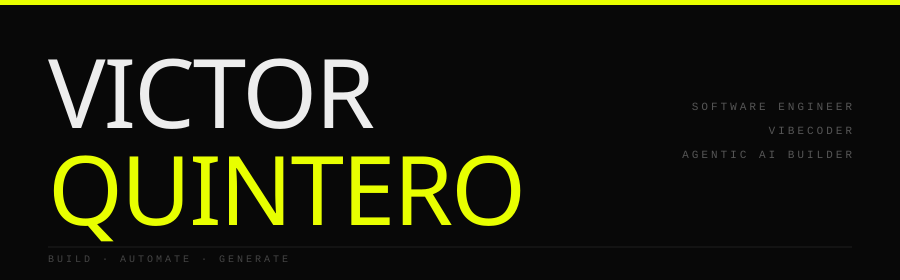
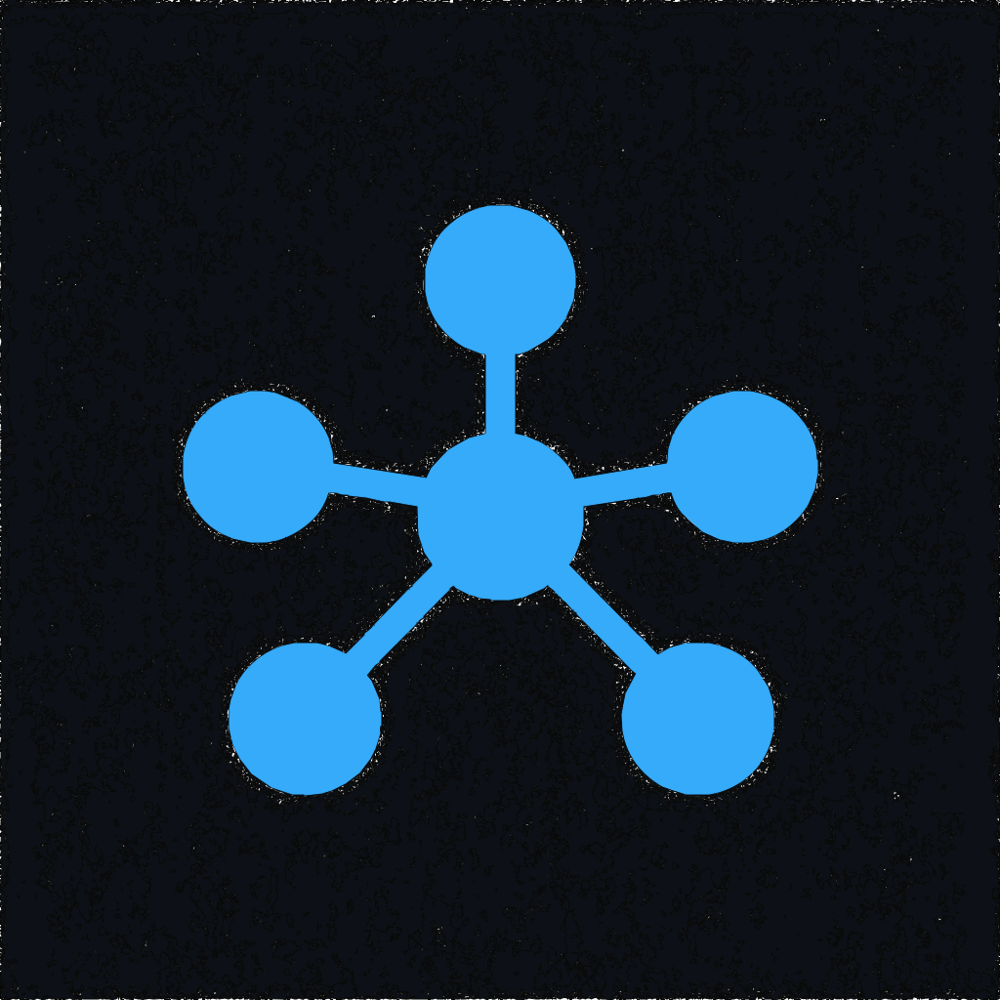
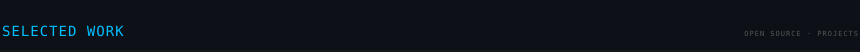
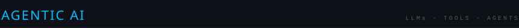
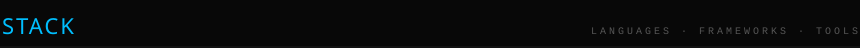
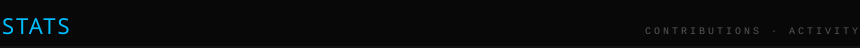

  &nbsp;&nbsp;&nbsp;&nbsp;&nbsp;&nbsp;&nbsp;&nbsp;
  &nbsp;&nbsp;&nbsp;&nbsp;&nbsp;&nbsp;&nbsp;&nbsp;
  

  I build <b>agentic and generative-media tools</b>: ComfyUI infrastructure and custom nodes, local agent skills, dataset and LoRA tooling, and TypeScript/Bun frameworks for AI-native apps. 
  My work turns messy creative workflows into reusable CLIs, nodes, plugins, and full-stack experiences.

 

Lately most of my time goes into **ComfyUI as a creative workspace and as infrastructure**: video extension nodes, a manga studio inside ComfyUI, LoRA dataset tooling, and packaging the ComfyUI engine so agents can call it as local tools.

- **ComfyUI as infrastructure**: importable Python modules, custom nodes, media servers, and deployment images
- **Agent-ready utilities**: skills and CLIs designed to be composed by AI coding workflows
- **Training pipelines**: curating, captioning, and training LoRA datasets locally or on Modal
- **Creative coding agents**: Codex inside tools like Krita and ComfyUI

 

### Most active right now

| Project | What it does | Stack |
|:---|:---|:---|
| **[ComfyUI-MinimaxH3-YAFVMinimaxCustomNodes](https://github.com/quinteroac/ComfyUI-MinimaxH3-YAFVMinimaxCustomNodes)** | MiniMax H3 video extend and audio/video encode nodes for ComfyUI, plus an in-node multimedia editor with timeline, preview, and drawing tools | `Python` `ComfyUI` |
| **[comfy-agent-tools](https://github.com/quinteroac/comfy-agent-tools)** | Skills-first local image, video, and music generation for agents, with Python CLIs backed by `comfy-diffusion` (no ComfyUI server needed) | `Python` `uv` `Agent skills` |
| **[ComfyUI-MangaMakerStudio](https://github.com/quinteroac/ComfyUI-MangaMakerStudio)** | A manga creation workspace inside ComfyUI: references, AI-generated panels, Klecks drawing, and page layouts with speech bubbles | `JavaScript` `ComfyUI` |
| **[dada-dataset-creator](https://github.com/quinteroac/dada-dataset-creator)** | Local app to create, caption, export, and train LoRA datasets for Anima, Qwen Image, Krea 2, MOSS-Image, and more, locally or on Modal | `Python` `FastAPI` `Modal` |
| **[comfy-diffusion](https://github.com/quinteroac/comfy-diffusion)** | Standalone Python package that exposes ComfyUI's inference engine as importable modules: no server, no node graph, no UI | `Python` `PyTorch` `PyPI` |

<b>More projects</b>

 

| | |
|:---|:---|
| **[codex-krita](https://github.com/quinteroac/codex-krita)** | Krita plugin for generating and editing images with Codex inside the creative workspace |
| **[ComfyUI-CodexNode](https://github.com/quinteroac/ComfyUI-CodexNode)** | Custom ComfyUI node that controls a local Codex agent from ComfyUI |
| **[reelpod-studio](https://github.com/quinteroac/reelpod-studio)** | Creator tool for AI-generated lo-fi music and visuals, with audio-reactive R3F visualizers |
| **[loki-creator](https://github.com/quinteroac/loki-creator)** | Creative canvas that combines local and remote AI image and video generation |
| **[biwa](https://github.com/quinteroac/biwa)** | TypeScript visual novel framework built around Ink, React, and Bun |
| **[ComfyUI-AnimaFastTrain](https://github.com/quinteroac/ComfyUI-AnimaFastTrain)** | Experimental ComfyUI custom node for fast in-memory Anima model training |
| **[ComfyUI-GameAssetsMaker](https://github.com/quinteroac/ComfyUI-GameAssetsMaker)** | Custom ComfyUI nodes for game asset preparation workflows |
| **[ComfyUI_DSS_Wrapper](https://github.com/quinteroac/ComfyUI_DSS_Wrapper)** | DiffSynth Studio wrapper with zero-shot image-to-LoRA nodes |
| **[parallax-ms](https://github.com/quinteroac/parallax-ms)** | Media server built on `comfy-diffusion` for local and remote generation APIs |
| **[zikon](https://github.com/quinteroac/zikon)** | CLI for generating icons and SVG assets from text prompts, installable as an agent skill |
| **[aurora](https://github.com/quinteroac/aurora)** | Agentic RPG where a Mastra agent narrates, builds the world, and generates media in real time |
| **[nerds-vibecoding-survivor-toolkit](https://github.com/quinteroac/nerds-vibecoding-survivor-toolkit)** | Spec-driven agentic development framework and CLI built on Bun |
| **[ComfyUI_ComfyAssistant](https://github.com/quinteroac/ComfyUI_ComfyAssistant)** | Natural language agent to control and explore ComfyUI workflows |
| **[comfyui-base-image](https://github.com/quinteroac/comfyui-base-image)** | Docker container for running ComfyUI on RunPod |

 

Systems where LLMs don't just generate text: they take actions, call tools, and complete multi-step tasks on their own.

- **Skill-based agents**: composable skills that give LLMs real capabilities ([comfy-agent-tools](https://github.com/quinteroac/comfy-agent-tools))
- **Agentic creative tools**: plugins and nodes that let agents operate inside media workflows
- **Agentic apps**: full-stack apps where an agent is the core runtime ([aurora](https://github.com/quinteroac/aurora))
- **Spec-driven development**: structured specs that guide agents through complex tasks ([nvst](https://github.com/quinteroac/nerds-vibecoding-survivor-toolkit))

 

**Languages and runtimes**&nbsp; `Python` · `TypeScript` · `JavaScript` · `Bun` · `ElysiaJS` · `FastAPI` · `React` · `Ink`

**Generative media**&nbsp; `ComfyUI` · `PyTorch` · `LoRA training` · `DiffSynth` · `Krita` · `Modal` · `RunPod` · `Docker`

**Agents and AI**&nbsp; `Codex` · `MCP` · `Mastra` · `Vercel AI SDK` · `Assistant UI` · `GitHub Copilot SDK` · `OpenAI API` · `Anthropic API`

 

  
  

 

  &nbsp;&nbsp;
  

